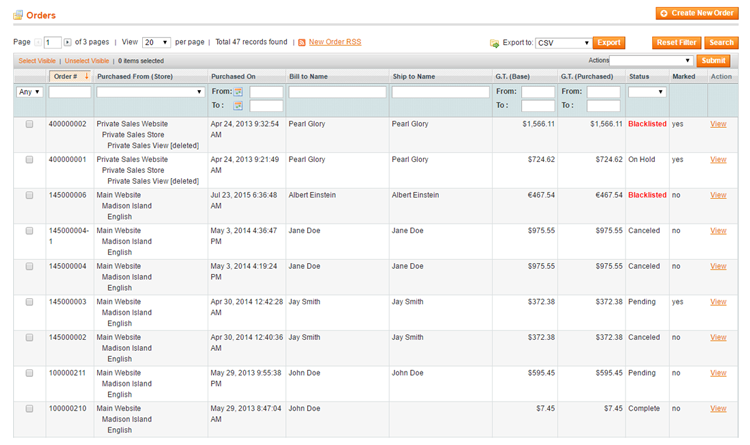
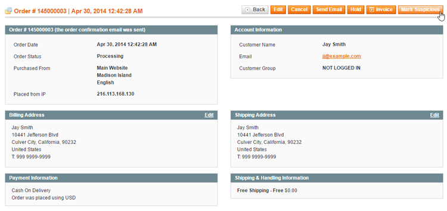
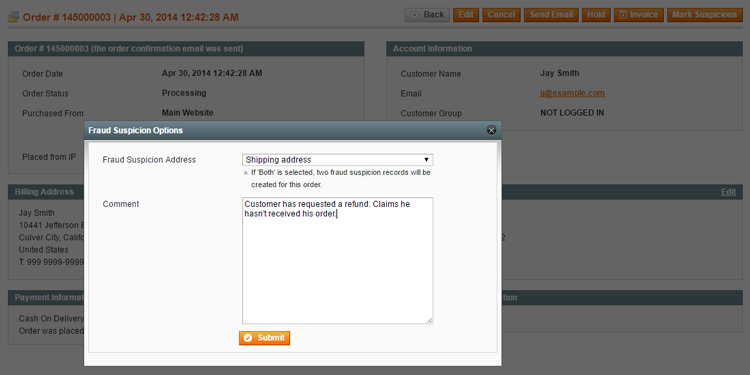
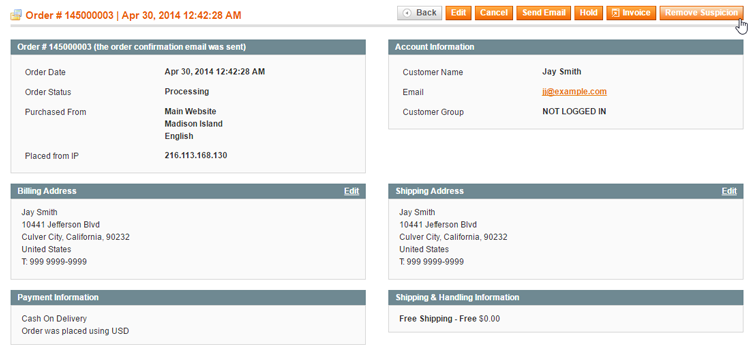
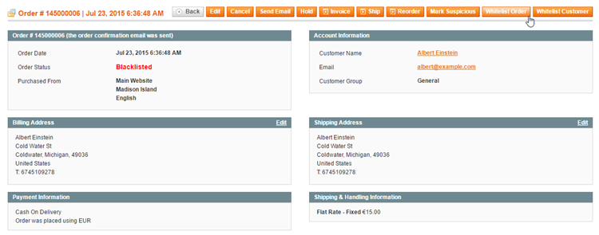

# Managing Suspicious and Blacklisted Orders

Using the Fraud Prevention extension suspicious and blacklisted orders are directly visible in the sales order grid, which can be filtered by 'Blacklisted' status and includes an additional 'Marked' column for fraud suspicions.

## Submitting Fraud Suspicions

To submit a new fraud suspicion, click the 'Mark Suspicious' button in the top right corner of the order view.

Depending on the configured [Fraud Suspicion Settings](./05-configuring-fraud-prevention.md), you can select which address type(s) should be included in the fraud suspicion record and optionally add a comment in the Fraud Suspicion Options pop-up.

## Removing Fraud Suspicions

A fraud suspicion can be removed by clicking the 'Remove Suspicion' button in the top right corner of the order view, automatically deleting the order's fraud suspicion record(s) as well.

## Whitelisting Orders and Customers

Blacklisted orders can be manually whitelisted again by clicking the 'Whitelist Order' button in the top right corner of the order view.

By clicking the 'Whitelist Customer' button, the current order as well as future orders by this customer will be whitelisted.

## Changing the Blacklisted Order Status

If you prefer to use a custom label for blacklisted orders, you can change this by navigating to **System > Order Statuses** and editing the Blacklisted order status label.

---

[Documentation index](./README.md) · [README](../README.md) · [Online version](https://plugin.company/knowledge-base/docs/magento-fraud-prevention/user-manual/managing-suspicious-and-blacklisted-orders/)
