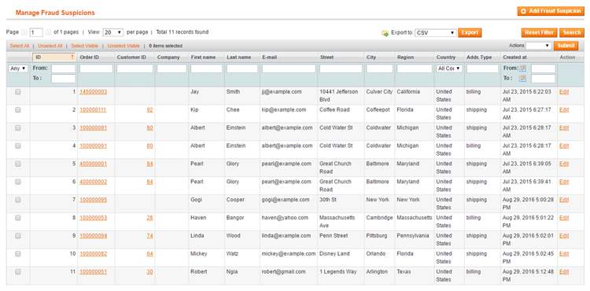
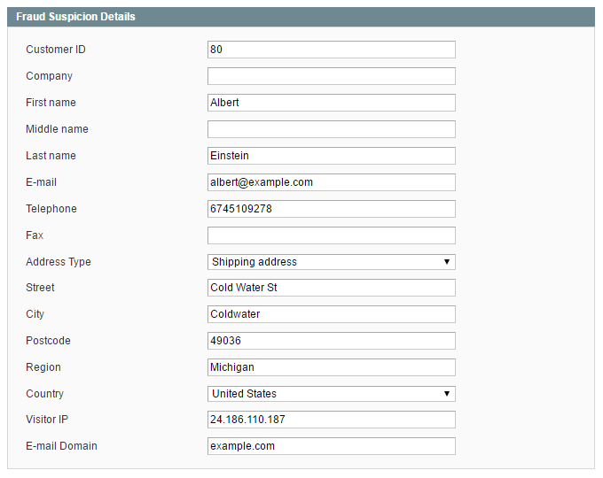
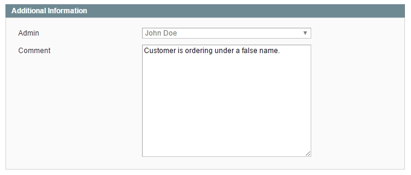

# Managing Fraud Suspicions

To manage submitted fraud suspicions, navigate to **Sales > Fraud Prevention > Fraud Suspicions** in the top Admin Panel menu.

Select a fraud suspicion record from the list or create a new record by clicking the 'Add Fraud Suspicion' button in the top right corner of the page.

Use the tabs in the Fraud Suspicion menu to view or edit the fraud suspicion record.

## Fraud Suspicion Details

In the Fraud Suspicion Details tab you can view and modify the customer attributes of the fraud suspicion record, including customer ID, name, contact information, address type and details, visitor IP and e-mail domain.

## Additional Information

In the Additional Information tab you can see which admin user has submitted the fraud suspicion and view or edit submitted comments.

---

[Documentation index](./README.md) · [README](../README.md) · [Online version](https://plugin.company/knowledge-base/docs/magento-fraud-prevention/user-manual/managing-fraud-suspicions/)
