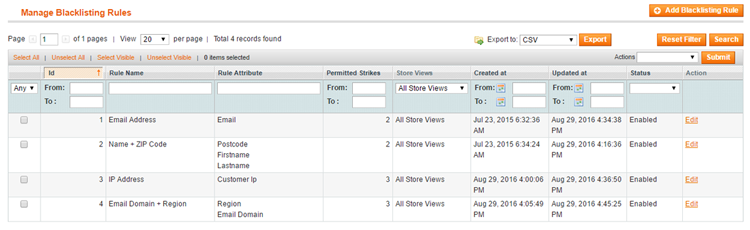
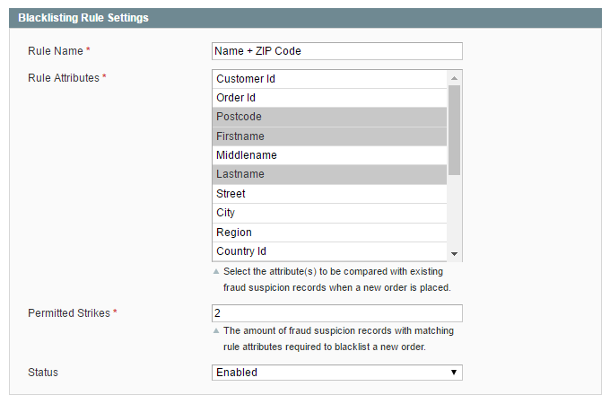
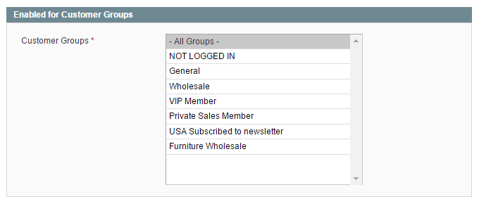

# Creating Blacklisting Rules

To create and manage blacklisting rules, navigate to **Sales > Fraud Prevention > Blacklisting Rules** in the top Admin Panel menu.

Create a new rule by clicking the 'Add Blacklisting Rule' button in the top right corner of the page.

Use the tabs in the Blacklisting Rule menu to configure the blacklisting rule as further explained below.

## Rule Settings

In the Rule Settings tab you can:

- Enter a rule name for admin reference.
- Select the attributes that should be compared with submitted [fraud suspicion records](./07-managing-fraud-suspicions.md) when a new order is placed.
- Define the permitted amount of 'strikes' or matching fraud suspicion records required to blacklist a new order. If a match is found and the permitted amount of strikes is exceeded, the order will be automatically blacklisted and blocked for shipping.
- Enable the rule to execute it each time a new order is submitted.

## Customer Groups

You can enable the rule for all customer groups or specific groups only in the Customer Groups tab.

## Store Views

If you have a multi-store setup in Magento, you can select the applicable store view(s) for the blacklisting rule in the Store Views tab.

---

[Documentation index](./README.md) · [README](../README.md) · [Online version](https://plugin.company/knowledge-base/docs/magento-fraud-prevention/user-manual/creating-blacklisting-rules/)
